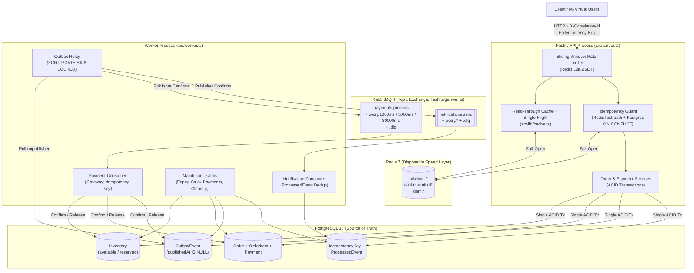
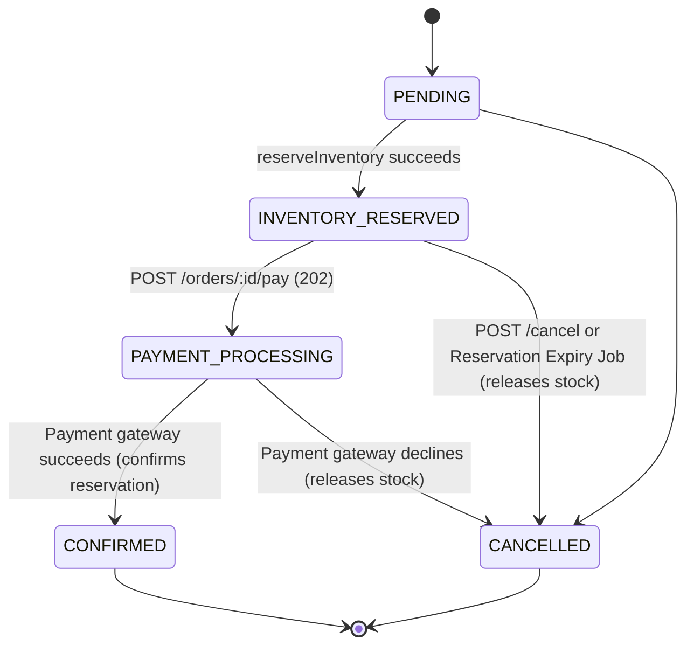

# FlashForge — High-Concurrency Flash-Sale Order Engine

[](https://github.com/tess3r4c7/FlashForge/actions/workflows/ci.yml)


FlashForge is a flash-sale order processing backend built with **Fastify, TypeScript, Prisma 7, PostgreSQL 17, RabbitMQ 4, and Redis 7**. Every component exists to solve a specific concurrency or distributed-systems failure mode — race-condition overselling, the database/broker dual-write problem, duplicate message delivery, client retry storms, cache stampedes, and dependency outages — and every claim is backed by **reproducible before/after k6 benchmarks** and **PostgreSQL conservation-law verification**.

---

## Measured Benchmarks — Before vs. After

All benchmarks run on a single laptop (AMD Ryzen 5 5600H, 6C/12T, Docker Compose) via [`loadtest/benchmark.ps1`](loadtest/benchmark.ps1) and are verified directly against PostgreSQL in a `REPEATABLE READ` transaction via [`loadtest/verify-db.ts`](loadtest/verify-db.ts). Full methodology and percentile tables are in **[`docs/BENCHMARKS.md`](docs/BENCHMARKS.md)**.

| Engineering Problem | Naive / Before | FlashForge / After | Measured Impact |
|---|---|---|---|
| **Flash-sale overselling**<br/>*(200 concurrent buyers, 10 units in stock, 3 runs)* | Application-level `SELECT` → check → `UPDATE` created **126–149 orders** (avg **135 orders** for 10 units; **oversold by 125 units**) | Single atomic `UPDATE … WHERE available >= qty` created **10 / 10 orders** across every run | **100% elimination of overselling** (**0** oversold units; all 5 DB conservation invariants hold) |
| **Catalog read bottleneck**<br/>*(50 concurrent VUs hammering `GET /products` for 20s)* | Uncached PostgreSQL queries: **561 req/s**, **149.2 ms p95**, **11,083** DB transactions | Redis read-through cache (`TTL=30s`): **1,960 req/s**, **35.6 ms p95**, **12** DB transactions (`GET /products/:id`: **1,151 → 3,586 req/s**) | **4.2× lower p95 latency**, **3.5× higher throughput**, **99.9% reduction in Postgres load** |
| **Redis outage during read spike**<br/>*(50 concurrent VUs, Redis unreachable)* | Offline command queue hangs requests or triggers a 50-VU database stampede | `enableOfflineQueue: false` fails open + in-process **single-flight coalescing** (**3,050 req/s**, **24.5 ms p95**, **1,191** DB queries across 61,364 requests) | **0% HTTP error rate** during cache outage; **98.1% stampede reduction** without Redis |
| **Slow payment gateway**<br/>*(external gateway takes **2,000 ms** per charge)* | Synchronous checkout: measured **2,042.8 ms p95** (2,031.6 ms median); only **102** orders completed in 30s | Transactional outbox + RabbitMQ worker returns `202 Accepted` in **19.9 ms p95** (**12.7 ms median**) | **103× faster checkout p95**; **2.9× higher throughput** (299 vs. 102 orders); **100%** of **299/299** confirmed |
| **Client retry storm**<br/>*(50 orders × 20 simultaneous retries = 1,000 requests)* | Without idempotency keys: **994 orders** created (**944 duplicate orders**) | Scoped `Idempotency-Key` (`INSERT … ON CONFLICT DO NOTHING` + canonical SHA-256 body hash + Redis replay): **50 orders** | **944 duplicate orders prevented** (**100% deduplication** under concurrent retries) |
| **Write capacity**<br/>*(50 concurrent VUs placing ACID orders for 20s)* | All 50 VUs contending on **1 hot SKU**: **112 orders/s** (**600.1 ms p95**) | 50 VUs spread across **50 SKUs**: **213 orders/s** (**308.6 ms p95**) | **1.9× write throughput** and **1.9× lower p95** when row locks don't serialize on one row |

---

## System Architecture



### Order State Machine

All status transitions are defined in [`src/domain/order-state-machine.ts`](src/domain/order-state-machine.ts) and enforced in the database via conditional `UPDATE "Order" SET status = $to WHERE id = $id AND status = $from` ([`transitionOrderStatus`](src/services/order.service.ts)) so racing requests (`pay` vs. `cancel`, or duplicate worker deliveries) can never corrupt state.



---

## Core Engineering Decisions (Why Every Piece Exists)

### 1. Preventing Overselling: Atomic Conditional `UPDATE` vs. Read-Then-Write
- **The bug:** A naive `SELECT availableQuantity` followed by an application-level `if (available >= qty)` and `UPDATE` fails under PostgreSQL's default `READ COMMITTED` isolation. Concurrent `SELECT`s do not block one another; in our 200-VU flash-sale benchmark, 126–149 transactions read positive stock, passed the check, and committed orders for 10 units. Worse, because each transaction wrote `inventory.availableQuantity - 1` from its stale read (a **lost update**), the `Inventory` row ended at `available = 0, reserved = 10` — hiding the oversell unless cross-checked against `OrderItem` rows.
- **The fix ([`src/services/inventory.service.ts`](src/services/inventory.service.ts)):** Combine the check and the mutation into one statement inside the order transaction:
  ```sql
  UPDATE "Inventory"
  SET "availableQuantity" = "availableQuantity" - $qty,
      "reservedQuantity"  = "reservedQuantity"  + $qty,
      "updatedAt"         = NOW()
  WHERE "productId" = $productId
    AND "availableQuantity" >= $qty;
  ```
  PostgreSQL acquires a row-level `FOR NO KEY UPDATE` lock on the matching row, serializing concurrent writers on that SKU and re-evaluating the `WHERE` clause against the newly committed values. If `updatedRows === 0`, we throw `ConflictError` (`409 Out of stock`) and the transaction rolls back all prior item reservations.
- **Why not `SELECT ... FOR UPDATE` or Redis distributed locks?** `SELECT ... FOR UPDATE` requires two round-trips instead of one and holds the row lock across application code. A Redis lock (Redlock) adds an external network hop on the critical path and is unsafe for correctness if a lock expires before the DB transaction commits. Letting PostgreSQL's row lock guard the invariant directly is both simpler and strictly serializable at the row level.

### 2. Eliminating Dual Writes: Transactional Outbox + `SKIP LOCKED` Relay
- **The bug:** Publishing directly to RabbitMQ after `prisma.$transaction()` commits creates a dual-write window: if the process crashes or RabbitMQ is unreachable after the DB commit, the order sits in `PAYMENT_PROCESSING` forever with no message in the broker. Publishing *inside* the transaction is worse — if the transaction later rolls back, the broker has already delivered a phantom event.
- **The fix ([`src/messaging/outbox.ts`](src/messaging/outbox.ts), [`src/messaging/outbox-relay.ts`](src/messaging/outbox-relay.ts)):** Every state change inserts an `OutboxEvent` row in the **same PostgreSQL transaction** as the business mutation. The API process never opens a RabbitMQ connection during request handling. In the worker process, the outbox relay polls unpublished rows using:
  ```sql
  SELECT * FROM "OutboxEvent"
  WHERE "publishedAt" IS NULL
  ORDER BY "createdAt" ASC
  LIMIT 50
  FOR UPDATE SKIP LOCKED;
  ```
  `FOR UPDATE SKIP LOCKED` lets multiple worker instances relay in parallel without ever claiming the same row, while stopping at the first publish error preserves event ordering during a broker outage.

### 3. Exactly-Once Effective Behaviour Over At-Least-Once Messaging
An outbox relay + RabbitMQ guarantees **at-least-once** delivery (if the relay crashes after publishing to RabbitMQ but before setting `publishedAt = NOW()`, it will publish again). FlashForge makes every downstream step idempotent:
- **Gateway idempotency keys ([`src/services/payment-gateway.ts`](src/services/payment-gateway.ts)):** Each payment attempt passes `idempotencyKey: "payment-<paymentId>"` to the gateway so a retry after a network timeout replays the original charge instead of double-charging the customer.
- **Timeout vs. Decline separation ([`src/services/payment.service.ts`](src/services/payment.service.ts)):** A card decline (`{ success: false }`) is a definitive business outcome → cancel the order and release reserved stock. A gateway timeout (`GatewayUnavailableError`) is an *unknown* outcome → throw so the consumer retries with the same idempotency key; never cancel an order whose charge might have succeeded.
- **Consumer deduplication ([`src/messaging/processed-events.ts`](src/messaging/processed-events.ts)):** Side-effecting consumers (`notification-worker`) insert `(consumer, eventId)` into `ProcessedEvent` inside the handler transaction. The insert uses `ON CONFLICT DO NOTHING` on the composite primary key: 0 rows inserted means a duplicate, which is acknowledged as a no-op (a simultaneous duplicate waits on the first copy's uncommitted row, then sees the conflict); if the handler throws, the transaction rolls back so the retry still executes.
- **Non-blocking retry queues + DLQ ([`src/messaging/rabbitmq.ts`](src/messaging/rabbitmq.ts), [`src/messaging/consumer.ts`](src/messaging/consumer.ts)):** Transient failures republish to per-delay TTL queues (`*.retry.1000ms`, `*.retry.5000ms`, `*.retry.30000ms`) that dead-letter back to the main queue when expired. Using one queue *per delay* avoids RabbitMQ's head-of-line TTL blocking (where a 30s message at the head of a single retry queue blocks a 1s message behind it). Exhausted or `NonRetryableError` messages land in `*.dlq` with diagnostic headers and can be inspected or replayed via `npm run dlq`.

### 4. API Idempotency & Self-Healing Background Jobs
- **Client retry deduplication ([`src/services/idempotency.service.ts`](src/services/idempotency.service.ts)):** `POST /orders` accepts `Idempotency-Key`. Inside the order transaction, `INSERT INTO "IdempotencyKey" ("userId", key, "requestHash", ...) ON CONFLICT DO NOTHING` atomically claims the key. Concurrent retries with the same `(userId, key)` block on PostgreSQL's unique-index lock until the winner commits, then replay the stored `201` response with `Idempotent-Replayed: true`. Reusing a key with a different payload returns `422 Unprocessable Entity` (fingerprinted via key-order-independent canonical SHA-256 JSON hashing). Completed responses are cached in Redis (`idem:<userId>:<key>`) so subsequent retries don't even open a DB transaction.
- **Self-healing jobs ([`src/jobs/`](src/jobs/)):**
  - `reservation-expiry.ts`: Cancels orders abandoned in `INVENTORY_RESERVED` past `RESERVATION_TTL_MS` (default 15m) and releases their stock back to `availableQuantity`.
  - `stuck-payments.ts`: Re-emits `payment.requested` for orders stuck in `PAYMENT_PROCESSING` (after `STUCK_PAYMENT_AFTER_MS`, default 5 min; up to `MAX_RECOVERY_ATTEMPTS = 3`).
  - `cleanup.ts`: Purges old published `OutboxEvent`, `ProcessedEvent`, and `IdempotencyKey` rows past retention.

### 5. Redis: Justified Use Cases & Strict Fail-Open Design
Redis is used **only** for disposable state where PostgreSQL is the wrong tool; losing Redis never corrupts data or takes down checkout ([`src/lib/redis.ts`](src/lib/redis.ts)):
- **Atomic sliding-window rate limiter ([`src/lib/rate-limiter.ts`](src/lib/rate-limiter.ts)):** Single Lua script (`ZREMRANGEBYSCORE` → `ZCARD` → conditional `ZADD` + `PEXPIRE`) enforces per-user limits on write routes in one round-trip with no check-then-act race.
- **Read-through product cache + single-flight ([`src/lib/cache.ts`](src/lib/cache.ts)):** Caches product metadata (`GET /products`, `GET /products/:id`), invalidated *after* `POST /products` commits. Concurrent cache misses within a process share one in-flight Promise so a cold key never triggers a DB stampede. Stock levels are deliberately **never** cached.
- **Fast fail-open:** Configured with `enableOfflineQueue: false`, `maxRetriesPerRequest: 1`, and a `200ms` command timeout. When Redis is down, commands reject immediately instead of queuing in memory, rate limiting allows traffic through, and cache/idempotency fall back to PostgreSQL.

### 6. Observability & Correlation Tracing
- **Async correlation propagation ([`src/lib/context.ts`](src/lib/context.ts)):** Every HTTP request gets an `X-Correlation-Id` (client-supplied or generated UUID) stored in Node's `AsyncLocalStorage`. Every Pino log line automatically includes `correlationId`, `createEvent()` stamps it into the event envelope that is stored in the `OutboxEvent` row and published to RabbitMQ unchanged, and the consumer restores it into `AsyncLocalStorage` before invoking the handler — giving a single trace ID across `HTTP → Postgres Outbox → RabbitMQ → Worker`.
- **Prometheus metrics (`GET /metrics`, [`src/lib/metrics.ts`](src/lib/metrics.ts)):** Exposes `http_requests_total`, `http_request_duration_seconds` (tagged by route pattern `/orders/:id` to prevent label cardinality explosion), `orders_created_total`, `payments_processed_total`, `outbox_published_total`, `outbox_pending_count`, `rate_limit_hits_total`, and `cache_hits_total` / `cache_misses_total`.

---

## Deliberate Scope Boundaries

- **No authentication / JWT:** Omitted intentionally to keep the codebase focused on concurrency control, messaging reliability, and failure recovery; requests pass `userId` in the body (seeded demo user `id = 1`).
- **Polling outbox vs. CDC (Debezium):** A `FOR UPDATE SKIP LOCKED` polling relay has zero extra infrastructure beyond PostgreSQL and adds at most one poll interval (200 ms by default) of delivery delay. At higher write volumes where polling overhead matters, tailing the WAL with Debezium is the natural drop-in replacement.

---

## Quick Start

### Option A — Local Development (Infra in Docker, App on Host)

```bash
# 1. Start PostgreSQL 17, RabbitMQ 4, and Redis 7
docker compose up -d

# 2. Install dependencies, run migrations, and seed demo user #1
cp .env.example .env
npm install
npm run db:generate
npm run db:migrate
npm run db:seed

# 3. Start API (port 3000) and Worker in separate terminals
npm run dev
npm run dev:worker
```

### Option B — Full Stack in Docker Containers

Uses the multi-stage [`Dockerfile`](Dockerfile) (`build`, `migrate`, `prod-deps`, and non-root `runtime` image — reduced from 787 MB to **459 MB** by stripping `devOptional` Prisma CLI/Studio dependencies):

```bash
docker compose --profile app up -d --build
# Scale background workers independently:
docker compose --profile app up -d --scale worker=3
```

---

## Testing & Verification

The test suite is split into two Vitest projects ([`vitest.config.ts`](vitest.config.ts)):
- **`unit` (54 tests, ~3s, no Docker required):** Exhaustively tests the 25-pair order state machine, canonical SHA-256 request hashing (which caught a real key-ordering bug where retries with reordered JSON keys returned `422`), retry schedule parsing, and the simulated payment gateway contract.
- **`integration` (93 tests, ~40s, real PostgreSQL + RabbitMQ + Redis):** Tests concurrent inventory contention, multi-item rollbacks, race conditions (`10 concurrent pays`, `pay vs. cancel`), outbox `SKIP LOCKED` concurrency, retry back-off + DLQ routing + replay, consumer deduplication under 10 simultaneous deliveries, idempotency keys, background expiry/recovery/cleanup jobs, sliding-window rate limiting, single-flight caching, Redis outage fail-open behavior, and end-to-end correlation ID tracing.

```bash
npm run test:unit          # 54 unit tests (runs without Docker)
npm run test:integration   # 93 integration tests (isolated flashforge_test DB, test.* queues, Redis DB 1)
npm run test:run           # All 147 tests
npm run test:coverage      # Full suite + V8 coverage report (88.3% lines, 87.6% statements)
```

### Running Load Tests & Benchmarks (k6)

```powershell
npm run loadtest:flash       # 200 VUs competing for 10 units + Postgres invariant check
npm run loadtest:sustained   # 10 VUs steady create + pay loop
npm run loadtest:mixed       # 20 VUs, 80% cached reads / 20% transactional writes
npm run bench                # Full before/after benchmark suite -> docs/BENCHMARKS.md
```

---

## API Summary

| Method & Path | Description | Key Headers / Status Codes |
|---|---|---|
| `POST /products` | Create product + initial inventory atomically (invalidates Redis product cache) | `201 Created` |
| `GET /products` | List products (Redis read-through cached + single-flight) | `200 OK` |
| `GET /products/:id` | Get product by ID (caches both hits and `404` misses) | `200 OK`, `404 Not Found` |
| `POST /orders` | Reserve inventory atomically, snapshot prices, create order + `order.created` outbox event | `Idempotency-Key` (optional) → `201 Created` (`Idempotent-Replayed: true` on replay), `409 Out of stock`, `422` key mismatch, `429` rate-limited |
| `GET /orders/:id` | Fetch order with items and payment record | `200 OK`, `404 Not Found` |
| `POST /orders/:id/pay` | Transition `INVENTORY_RESERVED → PAYMENT_PROCESSING`, create `Payment`, enqueue `payment.requested` | `202 Accepted`, `403 Forbidden`, `409 Conflict`, `429` rate-limited |
| `POST /orders/:id/cancel` | Cancel unpaid order, release reserved stock back to `availableQuantity`, enqueue `order.cancelled` | `200 OK`, `409 Conflict` |
| `GET /health` | Deep health check across PostgreSQL, RabbitMQ, and Redis | `200 OK` (`status: "ok" \| "degraded" \| "error"`) |
| `GET /metrics` | Prometheus metrics scrape endpoint | `200 OK` (`text/plain; version=0.0.4`) |
